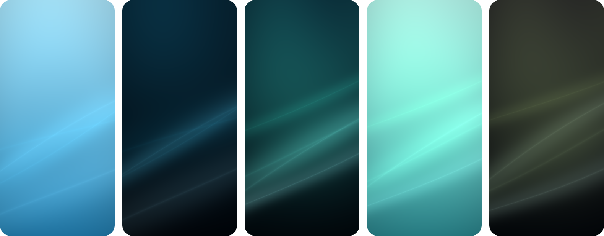

<p align="center"></p>

<h1 align="center">Air</h1>
<p align="center"><b>Glass, light and motion for Jetpack Compose</b> · by GREENTUNE</p>

Air brings back the depth of Windows Vista and 7 Aero and rebuilds it for modern Android: real backdrop blur, glossy glass, a candy-glass orb and a live GPU background that reacts to state, data flow and the tilt of the phone. It powers [Glyde](https://github.com/GrapeGG-developer/glyde).

<p align="center"></p>

## Features

- **Live background.** An AGSL ribbon-light shader with ambient aurora. `energy` lights it up, `pulse` makes it breathe with traffic, `accent` recolors it. Falls back to an animated gradient below Android 13.
- **Real glass.** `backdropSource()` records what is behind, `backdropBlur()` blurs it under panels and windows. `Modifier.glass()` adds the Aero gloss, rim and tint.
- **Orb.** A 3D glass sphere button with Off, Starting, On and Error states and a halo driven by `level`.
- **Tilt.** `TiltSensor` feeds `Motion.tilt`, which moves glare and light with the device.
- **Controls.** `AirButton`, `AirToggle`, `AirSlider`, `AirProgressBar`, `Segmented`, `SettingRow`, `ToggleRow`, `SectionTitle`, `Badge`, `StatusDot`, `AirDialog`.
- **Motion.** `staggerIn`, `pressBounce`, spring presets in `AirSpec`.
- **Theme.** Light, dark or system, any tint color, intensity slider, Glyde Sans typeface with Cyrillic.

## Install

```kotlin
dependencyResolutionManagement {
    repositories {
        maven("https://jitpack.io")
    }
}

dependencies {
    implementation("com.github.GrapeGG-developer:air:1.0.0")
}
```

Requires minSdk 29, Compose BOM 2025.06 or newer, Kotlin 2.2.

## Usage

```kotlin
AirTheme(theme = "system", tint = Color(0xFF19A7CE), intensity = 0.6f) {
    ProvideBackdrop {
        TiltSensor(enabled = true)
        Box(Modifier.fillMaxSize()) {
            Box(Modifier.fillMaxSize().backdropSource()) {
                AirBackground(enabled = true, energy = if (on) 1f else 0f, pulse = speed)
            }
            Column(Modifier.align(Alignment.Center), horizontalAlignment = Alignment.CenterHorizontally) {
                Orb(state = if (on) OrbState.On else OrbState.Off, level = speed, description = "Connect", onClick = { on = !on })
                GlassPanel(Modifier.padding(24.dp)) {
                    ToggleRow("Tilt", null, tilt, { tilt = it })
                }
            }
        }
    }
}
```

`sample/` is a full showcase app. Grab `air-sample.apk` from [Releases](https://github.com/GrapeGG-developer/air/releases) or run `./gradlew :sample:installDebug`.

## Structure

```
library/   gpr.greentune.air
  Theme.kt       colors, typography, AirTheme
  Background.kt  AirBackground, shader host
  Shaders.kt     AGSL sources
  Glass.kt       glass modifier, GlassPanel, AirWallpaper
  Backdrop.kt    backdrop recording and blur
  Orb.kt         glass orb button
  Controls.kt    buttons, toggles, sliders, rows
  Dialog.kt      AirDialog
  Motion.kt      tilt sensor, shader clock
  Anim.kt        AirSpec, staggerIn, pressBounce
sample/    showcase app
```

## License

Code: [Apache-2.0](LICENSE). Glyde Sans font: [SIL OFL 1.1](library/FONT-OFL.txt).
